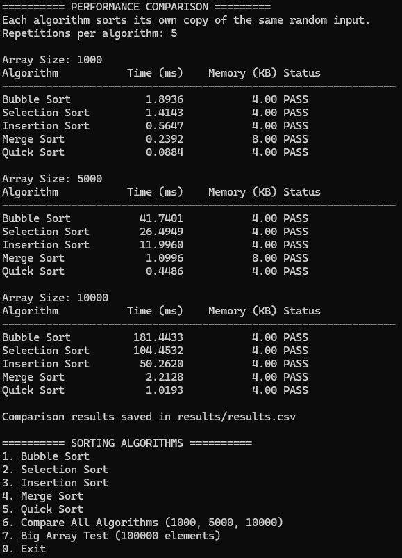
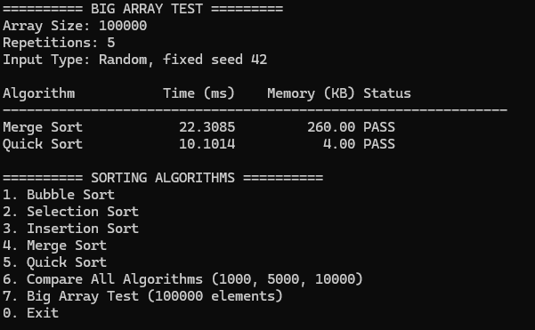

# Sorting Algorithms

## Implementation, Performance Measurement and Comparison

A C implementation of five sorting algorithms for the Algorithms and Data Structures module at Badji Mokhtar University, Annaba.

## Project Information

- **Student:** Elias Medjdoub
- **University:** Badji Mokhtar University, Annaba
- **Department:** Computer Science
- **Field of Study:** Computer Science and Automation (Double Major)
- **Module:** Algorithms and Data Structures
- **Academic Year:** 2025/2026
- **Programming Language:** C
- **Compiler:** GCC 14.2.0
- **Measurement APIs:** Windows QueryPerformanceCounter and GetProcessMemoryInfo

## 1. Project Objectives

The objective of this project is to implement five sorting algorithms from scratch using C.

We also compare their execution time and memory usage using different array sizes. The benchmark results are saved in a CSV file for further analysis.

No built-in sorting function is used.

## 2. Implemented Algorithms

The project includes five sorting algorithms:

1. **Bubble Sort:** Compares adjacent elements and swaps them when they are in the wrong order. An early-exit flag stops the algorithm when no swaps occur.
2. **Selection Sort:** Finds the smallest element in the unsorted part and moves it to the correct position.
3. **Insertion Sort:** Inserts each element into its correct position in the sorted part of the array.
4. **Merge Sort:** Divides the array into smaller parts, sorts them, and merges the results.
5. **Quick Sort:** Partitions the array around a pivot and recursively sorts the resulting parts.

For Quick Sort, the last element is used as the pivot.

## 3. Time and Space Complexity

| Algorithm | Best Case | Average Case | Worst Case | Auxiliary Space |
|---|---|---|---|---|
| Bubble Sort | O(n) | O(n²) | O(n²) | O(1) |
| Selection Sort | O(n²) | O(n²) | O(n²) | O(1) |
| Insertion Sort | O(n) | O(n²) | O(n²) | O(1) |
| Merge Sort | O(n log n) | O(n log n) | O(n log n) | O(n) |
| Quick Sort | O(n log n) | O(n log n) | O(n²) | O(log n) average, O(n) worst |

Quick Sort uses the last element as its pivot. Sorted or reverse-sorted arrays can produce unbalanced partitions and lead to O(n²) execution time.

## 4. Project Structure

```text
sorting-algorithms/
│
├── README.md
├── .gitignore
│
├── src/
│   ├── main.c
│   ├── sorting.c
│   ├── sorting.h
│   ├── benchmark.c
│   ├── benchmark.h
│   ├── utils.c
│   └── utils.h
│
├── tests/
│   └── test_sorting.c
│
├── results/
│   └── results.csv
│
└── screenshots/
    ├── comparison.png
    └── large-array.png
```

## 5. Requirements

To compile and run the project, you need:

- Windows
- GCC 14.2.0
- MSYS2 or MinGW-w64
- PowerShell or another terminal

## 6. Compilation and Execution

Open the project folder in your terminal.

Compile the application:

```bash
gcc -Wall -Wextra -std=c11 -Isrc src/main.c src/sorting.c src/utils.c src/benchmark.c -o sorting.exe -lpsapi
```

Run the program:

```powershell
.\sorting.exe
```

The interactive menu provides individual sorting tests, comparison mode, and a large array test.

## 7. Benchmark Methodology

To make the comparison fair, we followed the same procedure for all algorithms:

- Generate random integers using a fixed seed of 42.
- Give each algorithm its own copy of the original array.
- Run each benchmark five times.
- Calculate the average execution time.
- Measure execution time using Windows QueryPerformanceCounter.
- Measure process memory using GetProcessMemoryInfo.
- Export benchmark results to results/results.csv.

Array generation, copying, and output are excluded from the timed sorting operation.

Memory measurements represent the maximum observed increase in process private memory during sorting. A monitoring thread samples memory usage every millisecond. Short-lived peaks between samples might not be captured.

## 8. Performance Comparison

Menu option 6 compares all five algorithms using the following array sizes:

- 1,000 elements
- 5,000 elements
- 10,000 elements

Each algorithm runs five times for each array size.

## 9. Large Array Test

Menu option 7 tests Merge Sort and Quick Sort using an array containing 100,000 random integers.

The other three algorithms are excluded from this test because their quadratic time complexity makes them less suitable for large arrays.

## 10. Unit Testing

The test program checks the five algorithms using different input cases:

- Random data
- Already sorted data
- Reverse-sorted data
- Data containing duplicate values

Compile the tests:

```bash
gcc -Wall -Wextra -std=c11 -Isrc tests/test_sorting.c src/sorting.c src/utils.c -o test_sorting.exe
```

Run the tests:

```powershell
.\test_sorting.exe
```

## 11. Experimental Results

The experiments were performed using random arrays generated with a fixed seed of 42. Each algorithm was tested five times for each array size.

### 11.1 Performance Comparison

| Algorithm | 1,000 Elements (ms) | 5,000 Elements (ms) | 10,000 Elements (ms) |
|---|---:|---:|---:|
| Bubble Sort | 1.799340 | 41.742740 | 184.577080 |
| Selection Sort | 1.238360 | 26.416940 | 103.979580 |
| Insertion Sort | 0.572200 | 11.853860 | 48.087540 |
| Merge Sort | 0.243580 | 1.293060 | 2.008940 |
| Quick Sort | 0.086640 | 0.415820 | 0.975720 |

The results show a significant difference between the quadratic algorithms and the two divide-and-conquer algorithms.

Quick Sort achieved the lowest execution time for all three tested array sizes.



### 11.2 Large Array Results

The following results were obtained using 100,000 random integers.

| Algorithm | Average Time (ms) | Peak Additional Private Memory (KB) | Status |
|---|---:|---:|---|
| Merge Sort | 22.321220 | 416.00 | PASS |
| Quick Sort | 10.066840 | 4.00 | PASS |

Quick Sort achieved a lower execution time than Merge Sort in this experiment.

The memory measurements show a difference in additional private memory usage between the two implementations.



All tested algorithms successfully sorted their input arrays.

## 12. Machine Specifications

The experiments were performed on the following computer:

| Component | Specification |
|---|---|
| Processor | AMD Ryzen 5 4600H with Radeon Graphics |
| RAM | 19.42 GB |
| Operating System | Microsoft Windows 11 Pro |
| Compiler | GCC 14.2.0 (MSYS2) |
| Programming Language | C |

All benchmark results were collected on this machine.

## 13. Analysis and Limitations

The experimental results show that the performance of sorting algorithms changes as the array size increases.

Bubble Sort and Selection Sort become slower with larger arrays because of their O(n²) time complexity.

Insertion Sort performs well with small or nearly sorted arrays.

Merge Sort provides predictable O(n log n) time complexity, but requires additional memory.

Quick Sort achieved the best execution time in our experiments. However, its last-element pivot strategy has a worst-case complexity of O(n²).

There are also some limitations in our measurements:

- Benchmark results depend on the computer hardware and system conditions.
- Memory monitoring uses periodic samples, so short-lived memory peaks might be missed.
- The measured memory represents process-level usage, not a direct measurement of every allocation made by an individual algorithm.

## 14. Conclusion

In this project, we implemented five sorting algorithms using the C programming language.

We tested them with different array sizes, measured their execution time and memory usage, and compared the results.

Our experiments showed that Quick Sort performed best on the tested random arrays, while Merge Sort also provided good performance with large inputs.

This project helped us understand sorting algorithms, theoretical complexity, unit testing, and performance measurement.

## 15. Submission

The project includes:

- C source files.
- Header files.
- Unit tests.
- Benchmark results in CSV format.
- Screenshots of the experiments.
- Project documentation.

The source code and project files are available in the GitHub repository.

---

**Developed by Elias Medjdoub**

Badji Mokhtar University, Annaba

Academic Year 2025/2026clea